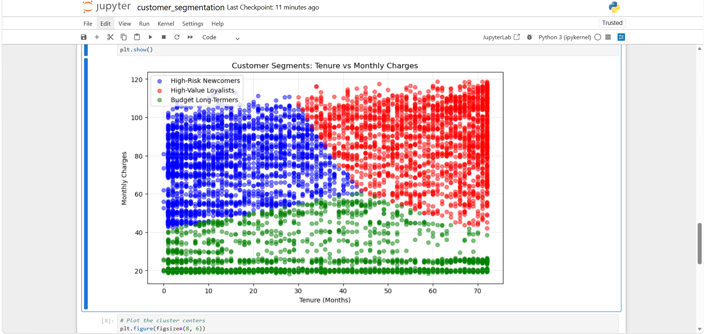

# Customer Segmentation & Retention Strategy (K-Means)

## Problem Statement
A telecom company wants to understand its customer base to create targeted marketing campaigns. The goal is to segment customers into distinct groups based on their tenure, monthly charges, and total charges to identify high-value customers and those at risk of churning.

## Dataset
- *Source:* IBM Telco Customer Churn (Kaggle)
- *Features Used:* tenure, MonthlyCharges, TotalCharges
- *Size:* 7,043 customers

## Methodology
1. *Data Preprocessing:* Converted TotalCharges to numeric and filled missing values with 0.
2. *Feature Scaling:* Applied StandardScaler to normalize the features, ensuring K-Means does not bias toward larger numbers (like TotalCharges).
3. *Optimal Clusters:* Used the *Elbow Method* to determine that 3 clusters was the optimal number for this dataset.
4. *Modeling:* Trained a KMeans clustering model (n_clusters=3).

## The 3 Customer Personas
Based on the cluster centers, we identified three distinct groups:

1. *The High-Risk Newcomers (Cluster 0):* ~13 months tenure, high monthly charges. These are new customers paying a premium who haven't built loyalty yet. 
   - *Action:* Target with welcome discounts or contract incentives to prevent early churn.
2. *The High-Value Loyalists (Cluster 1):* ~58 months tenure, highest monthly charges. These are the VIPs who have been with the company for years and spend the most. 
   - *Action:* Reward with premium upgrades and loyalty programs to retain them.
3. *The Budget Long-Termers (Cluster 2):* ~29 months tenure, very low monthly charges. These are long-term customers on basic plans. 
   - *Action:* Upsell them to bundled packages (e.g., adding internet or streaming) to increase their lifetime value.

## Visualizations

Scatter plot showing the clear separation of the 3 customer segments based on Tenure and Monthly Charges.

## Technologies Used
- *Languages:* Python
- *Libraries:* Pandas, Scikit-learn, Matplotlib, Seaborn
- *Environment:* Jupyter Notebook

## How to Run
1. Clone the repo: git clone https://github.com/Vandanakrishna84/telco-customer-segmentation.git
2. Install requirements: pip install -r requirements.txt
3. Open the Jupyter Notebook: jupyter notebook customer_segmentation.ipynb
